# Proxus Industrial MCP Server

<!-- mcp-name: io.github.proxusiiotplatform/proxus-mcp -->

Gives AI assistants such as Claude Desktop, Cursor and VS Code read-only access to industrial devices. Supports Modbus TCP and OPC UA (Basic256Sha256, Aes128_Sha256_RsaOaep or Aes256_Sha256_RsaPss with Sign or SignAndEncrypt, or unsecured; anonymous or user-name login).



*Condensed from a real session against simulated devices ([docs/demo.json](docs/demo.json)). More at [proxus.io/tools/industrial-mcp-server](https://proxus.io/tools/industrial-mcp-server/).*

## Tools

| Tool | What it does |
|---|---|
| `list_devices` | Configured devices, endpoint, ISA-95 path, connection state |
| `read_address` | Raw registers or bits: `hr:0`, `ir:10`, `coil:5`, `di:0` or `40001` |
| `watch_address` | Polls a Modbus address for 1–60 s and summarises how it moved, decoded as uint16, int16, uint32, int32 or float32 in any byte order |
| `decode_registers` | Up to 16 registers read every common way: int16/32, uint, float32 in ABCD/CDAB/BADC/DCBA, float64 in both word orders |
| `browse` | Children of an OPC UA node (default: Objects folder) |
| `read_nodes` | Up to 50 OPC UA variables with data type, quality, status code and source timestamp |
| `watch_nodes` | Watches up to 20 OPC UA variables for 1–60 s through a subscription: every change, plus first, last, min, max and average |
| `diagnose_connection` | Why a device can't be reached: name, TCP, protocol handshake, security and certificates, login, a test read, identity and clock, step by step with the next thing to try |
| `find_device_map` | Searches the register map library by vendor, model or alias, e.g. `PM5560` |
| `get_device_map` | A map's registers (key, address, type, byte order, unit, scale), filtered by a search word |
| `read_named` | Reads registers by key from the device's map and returns engineering values with units |

Nothing can write to a device.

## Register maps

With a register map the assistant reads `voltage_l1_n` instead of guessing that hr:0-1 is a word-swapped float.
A map lists every register of a device model: address, data type, byte order, scale (fixed, or a SunSpec scale-factor
register), unit and the meaning of enumerated values, with the vendor document it comes from.

Give a Modbus device its map in the configuration, by id or as the path of a map's JSON file:

```json
"meter-1": { "protocol": "modbus-tcp", "host": "192.168.10.40", "map": "schneider-electric/pm5500-pm5600-pm5700" }
```

`maps_dir` adds maps (or replaces built-in ones with the same id) from a folder of JSON files in the Modbus Register
Maps format. A map that does not exist stops the server at start-up with the reason. Maps tell the assistant how to
read a register, never to write one: `read_named` only reads.

## OPC UA security

Set `security_mode` (`sign_and_encrypt`, `sign` or `none`) and `security_policy` (`Basic256Sha256`,
`Aes128_Sha256_RsaOaep` or `Aes256_Sha256_RsaPss`) per device. Certificates live in `pki_dir` (default `pki/` next to the configuration file),
in the layout most OPC UA tools use:

| Folder | Holds |
|---|---|
| `own/` | This server's application certificate, created on first use (private key readable only by you) |
| `trusted/` | Server certificates you approved |
| `rejected/` | Server certificates seen but not approved |

Trust is never automatic, in either direction:

1. On the first connection the server's certificate lands in `rejected/` and the tool answers with its SHA-256
   thumbprint. Confirm the thumbprint with the server's administrator, then move the file to `trusted/`.
2. If the server answers `BadCertificateUntrusted` or `BadSecurityChecksFailed`, it has not trusted this client yet.
   `proxus-mcp certificate --config <file>` prints this server's certificate file and thumbprint to trust on the server.

Passwords never go in the configuration file: `password_env` names the environment variable that holds them. Errors
carry the OPC UA StatusCode name, the specification's description and a suggested next step.

## Install

Download the archive for your platform from the [releases](../../releases) page, unpack it, and point your MCP client
at the `proxus-mcp` binary (see Claude Desktop below). Each archive has a `.sha256` file next to it. The binaries are
not code-signed yet: on macOS run `xattr -d com.apple.quarantine proxus-mcp` once after unpacking, and on Windows
choose "More info, Run anyway" the first time.

`proxus-mcp --version` prints the version.

### Docker

```bash
docker run -i --rm -v "$PWD:/config" ghcr.io/proxusiiotplatform/proxus-mcp:<version>
```

The image reads `/config/proxus-mcp.json` and speaks MCP over stdin/stdout, so an MCP client starts it with
`docker` as the command and `run -i --rm -v <folder>:/config ghcr.io/proxusiiotplatform/proxus-mcp:<version>` as the
arguments. Devices on the host are reachable as `host.docker.internal`; on Linux add `--network host` to reach the
plant network directly. Images are published for linux/amd64 and linux/arm64.

## Build

Needs the .NET 10 SDK. The protocol drivers come from the [Proxus.Drivers](https://github.com/proxusiiotplatform/proxus-drivers) NuGet packages (Apache-2.0).

```bash
dotnet publish src/Proxus.Mcp.Server -c Release -r osx-arm64 -o artifacts/osx-arm64
```

The result is one native file, `artifacts/osx-arm64/proxus-mcp` (about 10 MB).

## Claude Desktop

Add to `claude_desktop_config.json`:

```json
{
  "mcpServers": {
    "proxus": {
      "command": "/absolute/path/to/proxus-mcp",
      "args": ["--config", "/absolute/path/to/proxus-mcp.json"]
    }
  }
}
```

Copy `proxus-mcp.example.json` as a starting configuration.

## Tests

- `dotnet test tests/Proxus.Mcp.Tests`: unit tests, no devices needed.
- `tests/smoke/run_all.sh`: the published binary against Modbus and OPC UA simulators (see `tests/smoke/README.md`).
- CI (`.github/workflows/ci.yml`) runs both and publishes Native AOT binaries for linux-x64, linux-arm64, win-x64 and
  osx-arm64.

## Licence

Apache-2.0, see `LICENSE`.
